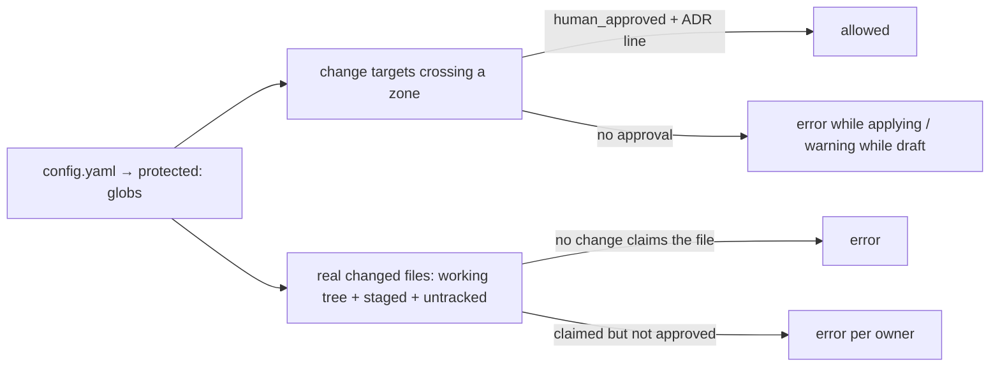

# Gates

Two mechanisms keep the system honest:

- **The mechanical gate** (`scripts/gates/gate-check.mjs`) — deterministic, dependency-free Node. It runs on pre-commit, in CI, and before archiving. It **measures and records**; it fixes nothing.
- **The semantic pass** (`/spec-verify`) — an advisory audit by an agent: requirements without implementation, implemented behavior no spec describes, tests that prove something else, opaque code. Findings are persisted in `findings.md`.

## What the mechanical gate checks

In order:

1. **Metadata and states** — `status` and `kind` enums; `reason`; `superseded_by`.
2. **Overlaps** — target containment and globs; an error only when the work is `applying`, and dependency-sequenced pairs warn instead.
3. **Tests** — every `[@test]` path exists; `fix` and `refactor` changes carry a regression test.
4. **Open work items** — `tasks.md` and `findings.md` open items warn on an `applying`/`verified` change.
5. **Tech brief** — `walkthrough.md` completeness and the comprehension sign-off (warning in static mode, error in `--pre-archive`).
6. **Waivers** — a valid granted waiver enables; `requested` and expired ones block.
7. **Decisions and conflicts** — pending entries block `verified` and `--pre-archive`.
8. **Protected zones** — declared `targets` plus real changed files (working tree, staged, untracked), with the `DECISIONS.md` cross-check.
9. **Capabilities** — the registry, new-capability collisions, `ARCHITECTURE.dsl` tags in both directions; requirement IDs and citations.
10. **Dependencies** — resolve by exact id against active, archived, and compacted changes.
11. **Archive hygiene** — unclosed waivers, decisions, or conflicts.
12. **Test suite** (`--run-tests`) — runs `test_command`; a red suite is a global error.
13. **Evidence** — merge across runs, and content-fingerprint staleness.
14. **`--pre-archive` preconditions**, when requested.

Every run ends with a report, an updated `evidence.json`, and an exit code: `0` when there are no errors, `1` otherwise.

## Modes and flags

| Flag | What it does |
|---|---|
| *(none)* | **Static** — seconds; the pre-commit mode. Produces no green |
| `--run-tests` | Runs the project's `test_command` and records **green test evidence** — the CI/verification mode |
| `--pre-archive <id>` | Archive preconditions for one change — a fully green run is required (any global error blocks); includes tech brief + comprehension sign-off |
| `--diff <base>` | Protected files touched without approval, plus code files unclaimed by any active change (scope drift), against a git base — for CI |
| `--scope <id>` | Local focus: reds **from other changes** become warnings. **Report only** — evidence and `gate_ok` are always computed unfiltered |
| `--tests-command "CMD"` | Runs `CMD` in **substituted** mode: evidence is recorded but never green. Forbidden in CI |
| `--json` | Machine-readable report |
| `--root DIR` | Repo root (defaults to the nearest ancestor with `openspec/changes`) |

Every run writes `openspec/evidence.json`.

## Evidence rules

```mermaid
flowchart TD
    R["gate-check --run-tests"] -->|test_command exits 0| G[green recorded for changes without gate errors]
    G --> Q{targets/tests content changed after the run?<br/>(fingerprint; commits alone do not stale)}
    Q -->|no| OK[valid green]
    Q -->|yes| S[STALE — warning in static, error in --pre-archive]
    T[static run] -->|verified without stored green| W[warning]
    C["--tests-command"] --> X[substituted — never green]
```

- Green is per change and merged across runs: a valid previous green is kept until it goes stale.
- `--pre-archive` requires **fresh** green **and** a green suite in the same run. Re-run `--run-tests` before archiving if the content moved (any edit — even uncommitted — counts) or the suite is red.
- Static mode treats missing green as a warning, so it never blocks your local commit; CI is the real barrier.

## Protected zones



## Gate policy

| Moment | Command |
|---|---|
| pre-commit (hook) | `node scripts/gates/gate-check.mjs` (static) |
| CI on pull request | `node scripts/gates/gate-check.mjs --run-tests --diff <base>` + `openspec validate --all --strict` |
| before archiving | `node scripts/gates/gate-check.mjs --pre-archive <id>` must be OK |
| weekly (advisory) | `/spec-verify` — the semantic pass |

`--scope` is for local commits only. Do not use it in CI: it changes the report, and CI exists precisely to see the whole truth.

## Archive compaction

`compact-archive.mjs --days=90 [--apply]` collapses archived changes older than N days into one line per change in `archive/YYYY.md`. Safety rules: it refuses to delete anything that is dirty, uncommitted, or unverifiable; `--force` skips the git verification but **never** deletes dirty content. Default is a dry run.
