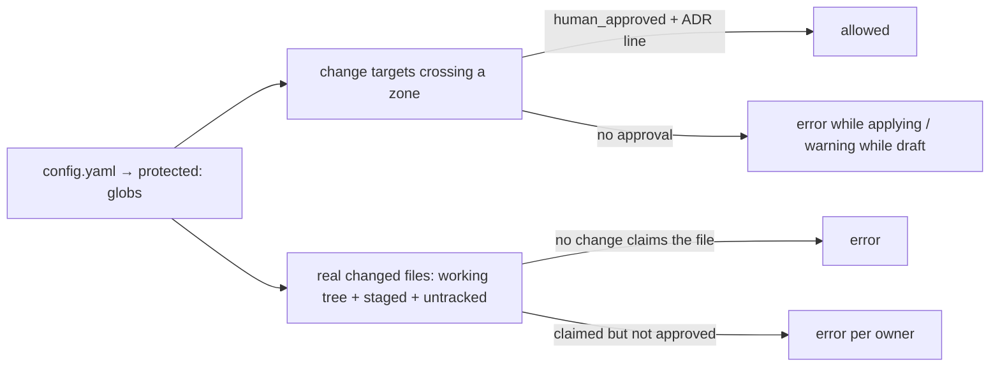

# Gates

Two mechanisms keep the system honest:

- **The mechanical gate** (`scripts/gates/gate-check.mjs`) — deterministic, dependency-free Node. It runs on pre-commit, in CI, and before archiving. It **measures and records**; it fixes nothing.
- **The semantic pass** (`/spec-verify`) — an advisory audit by an agent: requirements without implementation, implemented behavior no spec describes, tests that prove something else. Findings are persisted in `findings.md`.

## What the mechanical gate checks

```mermaid
flowchart TD
    A[parse .openspec.yaml and specs] --> B[status and kind enums; reason; superseded_by]
    B --> C[overlaps: containment + globs<br/>error only with applying work; deps-sequenced pairs → warning]
    C --> D["[@test] paths exist; fix/refactor need a regression"]
    D --> D2[tech brief: walkthrough + comprehension sign-off<br/>tasks.md / findings.md open items]
    D2 --> E[waivers: valid granted enables; requested/expired block]
    E --> F[open decisions and conflicts]
    F --> G[protected zones: targets + real changed files + ADR cross-check]
    G --> H[capabilities: registry, new-capability collisions,<br/>ARCHITECTURE.dsl tags (both ways); requirement IDs; citations]
    H --> I[deps resolve by exact id against active/archived/compacted]
    I --> J[archive hygiene: unclosed waivers/decisions/conflicts]
    J --> K[test suite: --run-tests]
    K --> L[evidence merge + content-fingerprint staleness]
    L --> M[--pre-archive preconditions, when requested]
    M --> N[report + evidence.json + exit code]
```

## Modes and flags

| Flag | What it does |
|---|---|
| *(none)* | **Static** — seconds; the pre-commit mode. Produces no green |
| `--run-tests` | Runs the project's `test_command` and records **green test evidence** — the CI/verification mode |
| `--tests-command "CMD"` | Runs `CMD` in **substituted** mode: evidence is recorded but never green. Forbidden in CI |
| `--scope <id>` | Local focus: reds **from other changes** become warnings. **Report only** — evidence and `gate_ok` are always computed unfiltered |
| `--pre-archive <id>` | Archive preconditions for one change — a fully green run is required (any global error blocks); incl. tech brief + comprehension sign-off |
| `--diff <base>` | Protected files + unclaimed code files (scope drift) against a git base — for CI |
| `--json` | Machine-readable report |
| `--root DIR` | Repo root (defaults to the nearest ancestor with `openspec/changes`) |

Exit code: `0` when there are no errors, `1` otherwise. Every run writes `openspec/evidence.json`.

## Evidence rules

```mermaid
flowchart TD
    R["gate-check --run-tests"] -->|test_command exits 0| G[green recorded for changes without gate errors]
    G --> Q{targets/tests content changed after the run?<br/>(fingerprint; commits alone do not stale)}
    Q -->|no| OK[valid green]
    Q -->|yes| S[STALE — warning in static, error in --pre-archive]
    T[static run] -->|verified without stored green| W[warning]
    C["--tests-command"] --> X[substituted — never green]
```

- Green is per change and merged across runs: a valid previous green is kept until it goes stale.
- `--pre-archive` requires **fresh** green and a green suite in the same run: re-run `--run-tests` before archiving if the content moved (any edit — even uncommitted — counts) or the suite is red.
- Static mode treats missing green as a warning (it must not block your local commit); CI is the real barrier.

## Protected zones



## Gate policy

| Moment | Command |
|---|---|
| pre-commit (hook) | `node scripts/gates/gate-check.mjs` (static) |
| CI on pull request | `node scripts/gates/gate-check.mjs --run-tests --diff <base>` + `openspec validate --all --strict` |
| before archiving | `node scripts/gates/gate-check.mjs --pre-archive <id>` must be OK |
| weekly (advisory) | `/spec-verify` — the semantic pass |

`--scope` is for local commits only. Do not use it in CI: it changes the report, and CI exists precisely to see the whole truth.

## Archive compaction

`compact-archive.mjs --days=90 [--apply]` collapses archived changes older than N days into one line per change in `archive/YYYY.md`. Safety rules: it refuses to delete anything that is dirty, uncommitted, or unverifiable; `--force` skips the git verification but **never** deletes dirty content. Default is a dry run.
