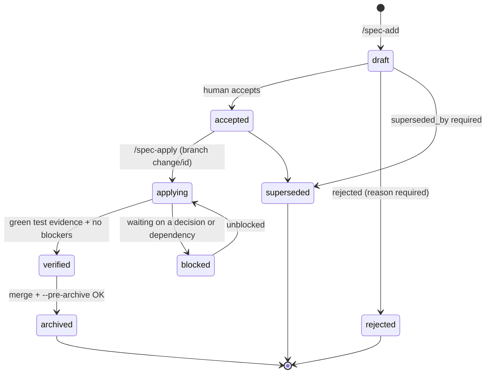
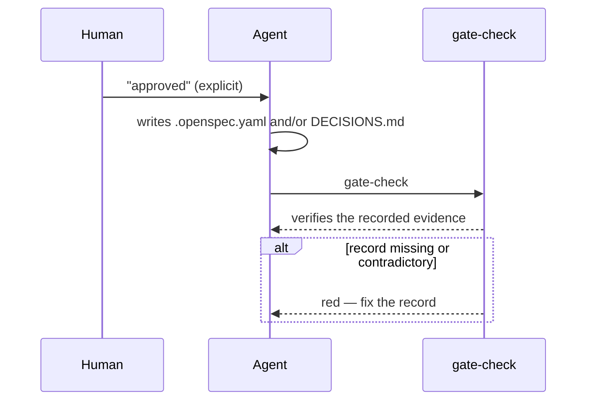

# Lifecycle & approvals

## The life of a change



The gate does not run a transition engine: it validates the **invariants of the recorded state** (a `verified` without local green evidence is a warning; with pending decisions it is an error, and so on). Transitions are process, not plumbing.

## The approval circuit

One rule for everything: **the human authorizes with an explicit sentence; the agent writes the record; the gate verifies the record.** Never the other way around, never by silence.



You do not have to edit files by hand: say "approved" to the agent in any session, or run `/spec-resolve`, which walks you through each pending item. Hand-editing works too — the gate checks the record, not the author (that is a documented limit; the risky approvals are cross-checked against `DECISIONS.md`).

## What to record for each kind of approval

| Approval | Where | Exact record |
|---|---|---|
| **Accept a change** (`draft → accepted`) | `.openspec.yaml` | `status: accepted` + `accepted_by: "<name>"` + `accepted_at: "<date>"` |
| **Protected zone** | `.openspec.yaml` + `DECISIONS.md` | `human_approved: true` + a line in `DECISIONS.md` containing `approved` (or `aprobado`) and the change id as a standalone word — and no `rejected`/`rechazado` in that line |
| **Grant a waiver** | `.openspec.yaml` | `state: granted` + `owner: "<name>"` + `expires: "YYYY-MM-DD"` (the date is yours; the agent asks for it) |
| **Reject a waiver** | `.openspec.yaml` | remove the waiver entry |
| **Resolve a decision** | `.openspec.yaml` + `DECISIONS.md` | remove the `open_decisions` entry + an ADR entry documenting the answer |
| **Approve a conflict ⚔** | `.openspec.yaml` + `DECISIONS.md` | remove the `conflicts` entry + an ADR entry documenting the reversal (which previous decision is replaced, and why) |
| **Reject a change** | `.openspec.yaml` | `status: rejected` + `reason: "…"` |
| **Supersede a change** | `.openspec.yaml` | `status: superseded` + `superseded_by: "<new-id>"` |

### Example: accepting a change

```yaml
status: accepted
accepted_by: "Nicolas"
accepted_at: "2026-10-16"
```

The gate only warns if these fields are missing — but they are the acceptance record, so fill them.

### Example: approving a protected zone

`.openspec.yaml`:

```yaml
human_approved: true
```

`DECISIONS.md` (append-only):

```md
## [2026-10-16] Approve dark-mode storage migration (change: dark-mode)
- **Context:** the change rewrites app/src/main/**/storage/** (user data)
- **Decision:** approved — the migration is additive and covered by the new tests
- **Consequences:** none pending
- **Refs:** openspec/changes/dark-mode/.openspec.yaml
```

The gate accepts a line that contains an approval word (`approved`, `aprobado`) and the change id (here `dark-mode`) as a **standalone word**, and rejects lines that also say `rejected`/`rechazado`. Mentioning `dark-mode-extra` does not count for `dark-mode`.

## What awaits you

`BOARD.md` (generated) is the single view of pending work:

- 🔒 Awaiting your approval (protected zones)
- ⏸ Awaiting your decision (open decisions and ⚔ conflicts)
- In progress · Drafts · Blocked / rejected
- ⚠ Registered waivers (pending and in force)
- Archive + warnings

Regenerate it any time with `node scripts/gates/build-board.mjs`, or run `/spec-resolve` to be walked through each item.
