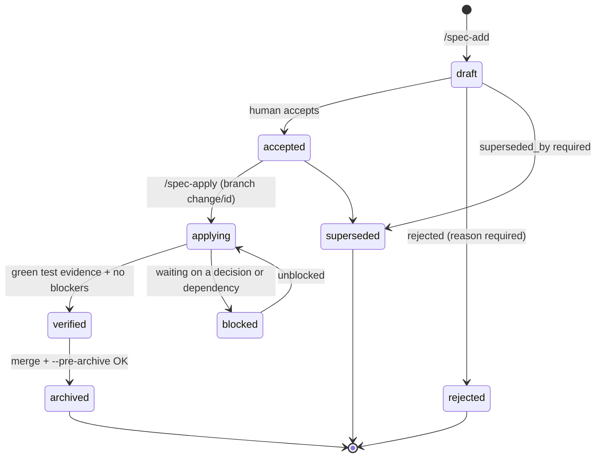
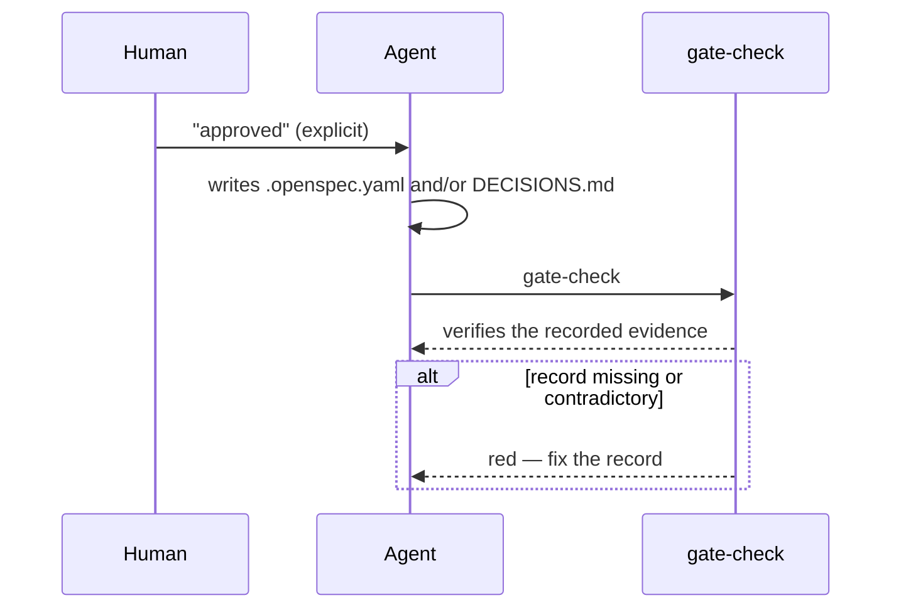

# Lifecycle & approvals

How a change moves from idea to archive, and exactly what each approval records.

## The life of a change



There is no workflow engine: the transitions are what you do next, and the gate only validates the **invariants of the recorded state** — a `verified` without local green evidence is a warning, with pending decisions it is an error, and so on.

The **child sessions** `/spec-apply` and `/spec-verify` dispatch (the gate, the per-change audit, the tech brief) never change a state and never record anything human-only: they read, and only `spec-walkthrough` writes inside the change folder. States, records and approvals are exactly as below ([Speed](speed.md)).

## The approval circuit

One rule covers every approval: **the human authorizes with an explicit sentence; the agent writes the record; the gate verifies the record.** Never the other way around, never by silence.



You do not have to edit files by hand: say "approved" to the agent in any session, or run `/spec-resolve`, which walks you through each pending item. Hand-editing works too, because the gate checks the record, not its author (a documented limit — the risky approvals are cross-checked against `DECISIONS.md`).

## What to record for each kind of approval

| Approval | Where | Exact record |
|---|---|---|
| **Accept a change** (`draft → accepted`) | `.openspec.yaml` | `status: accepted` + `accepted_by: "<name>"` + `accepted_at: "<date>"` |
| **Protected zone** | `.openspec.yaml` + `DECISIONS.md` | `human_approved: true` + an approval entry in `DECISIONS.md`: the change id and the approval word (`approved`/`aprobado`) in the same `##` section (id in the heading, approval below, is the normal shape); `rejected`/`not approved` never counts |
| **Grant a waiver** | `.openspec.yaml` | `state: granted` + `owner: "<name>"` + `expires: "YYYY-MM-DD"` (the date is yours; the agent asks for it) |
| **Reject a waiver** | `.openspec.yaml` | remove the waiver entry |
| **Resolve a decision** | `.openspec.yaml` + `DECISIONS.md` | remove the `open_decisions` entry + an ADR entry documenting the answer |
| **Approve a conflict ⚔** | `.openspec.yaml` + `DECISIONS.md` | remove the `conflicts` entry + an ADR entry documenting the reversal (which previous decision is replaced, and why) |
| **Comprehension sign-off** (tech briefs) | `walkthrough.md` + `.openspec.yaml` | answer the 3 questions in `/spec-verify` (free recall) → the agent transcribes your answers + records `understood_by` + `understood_at` |
| **Reject a change** | `.openspec.yaml` | `status: rejected` + `reason: "…"` |
| **Supersede a change** | `.openspec.yaml` | `status: superseded` + `superseded_by: "<new-id>"` |

### Example: accepting a change

```yaml
status: accepted
accepted_by: "Nicolas"
accepted_at: "2026-10-16"
```

The gate only warns when these fields are missing — but they are the acceptance record, so fill them in.

### Example: approving a protected zone

`.openspec.yaml`:

```yaml
human_approved: true
```

`DECISIONS.md` (append-only):

```md
## [2026-10-16] Approve dark-mode storage migration (change: dark-mode)
- **Context:** the change rewrites app/src/main/**/storage/** (user data)
- **Decision:** approved — the migration is additive and covered by the new tests
- **Consequences:** none pending
- **Refs:** openspec/changes/dark-mode/.openspec.yaml
```

The gate looks inside each `##` section: if the heading mentions the change id as a word (`dark-mode`), any approval line in that section counts — so the shape above works. Without a heading, the id and the approval word must share the same line. Negations (`rejected`, `not approved`, `disapproved`) never count, and a mention of `dark-mode-extra` does not count for `dark-mode`.

## What awaits you

`BOARD.md` (generated) is the single view of pending work:

- 🔒 Awaiting your approval (protected zones)
- ⏸ Awaiting your decision (open decisions and ⚔ conflicts)
- 🧠 Awaiting your comprehension (tech briefs: walkthrough ready, sign-off pending)
- In progress · Drafts · Blocked / rejected
- ⚠ Registered waivers (pending and in force)
- Capabilities (living specs, with ARCHITECTURE.dsl tag status)
- Dependency graph (declared deps)
- Archive + warnings

Regenerate it any time with `node scripts/gates/build-board.mjs`, or run `/spec-resolve` to be walked through each item. For the read-only view of the non-archived specs and their declared deps alone, run `/spec-deps-graph`.
