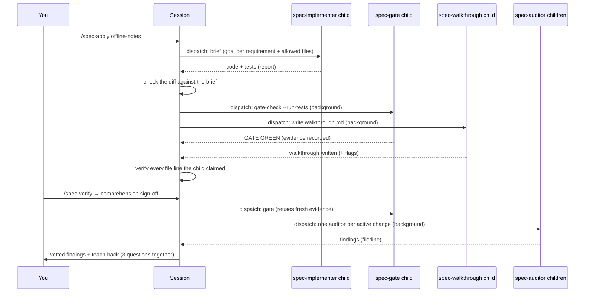
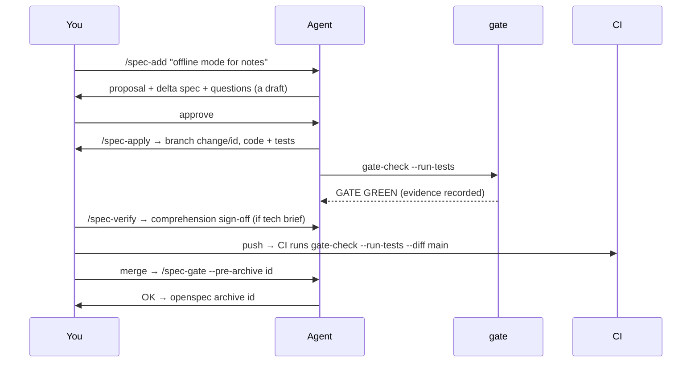
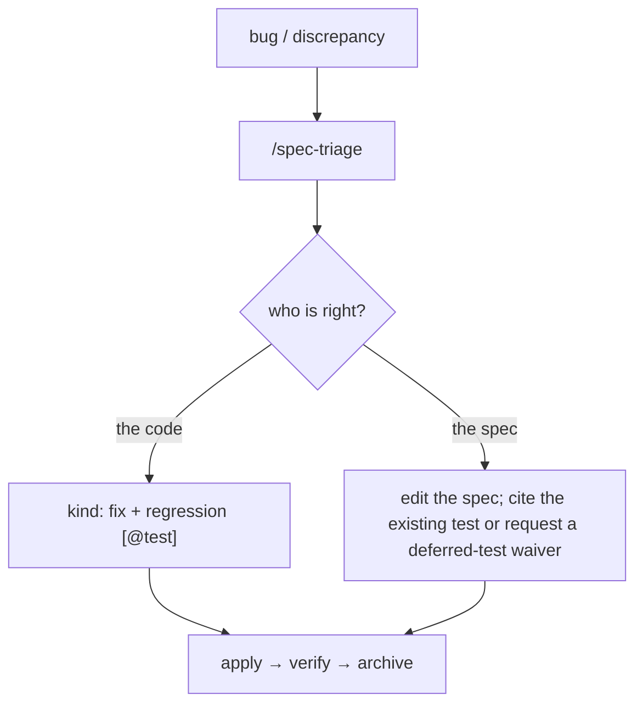

# Workflows

Recipes for the situations that come up most. All of them assume the repository has been bootstrapped (see the [README](../README.md#quickstart)).

## 0. What runs in the background (the commands that dispatch)

| Command | What goes out (in one batch) | What stays with you |
|---|---|---|
| `/spec-add` | `spec-recon`: reuse candidates, protected zones, overlaps, prior decisions | the single round of questions + the draft |
| `/spec-triage` | `spec-explainer` (the code side) + `spec-recon` (the spec side) | the one question: who is right? |
| `/spec-apply` | `spec-implementer`, then `spec-gate` + `spec-walkthrough` | the brief, the approvals, the join |
| `/spec-verify` | `spec-gate` + one `spec-auditor` per active change | the teach-back, the vetted report |
| `/spec-explain` | `spec-explainer` (one per independent behavior, cap 3) | verifying the hops and delivering it in its own words |
| `/spec-resolve` | — (one `question` round replaces N turns) | every decision |
| `/spec-gate` · `/spec-deps-graph` · `/diagram-sync` | the whole command is the child | — |

The two rules: **independent work goes out in one batch**, and **what a child returns is a claim** until the parent checks it (the diff against the brief, the `file:line`s against the code). Nothing human-only is delegated.

`/spec-apply` and `/spec-verify` in detail:



1. `/spec-apply` **orients, then hands the implementation** to the `spec-implementer` child with a precise brief: the goal per requirement, the allowed files (`targets` + `tests`) and the reuse-first ladder. The child is a fresh context by construction. Risky changes (architecture, protected zone, anything that would need a question mid-way) are implemented in the session instead — a child has nobody to ask.
2. The parent **checks the diff against the brief** and, as soon as the code and tests hold, launches the gate and the tech-brief drafter **in one batch**.
3. `/spec-verify` launches the gate and **one read-only auditor per active change** (capped at 6; beyond that, group by capability) and runs the teach-back while they work.
4. The parent **vets** everything that came back: a changed file outside the brief, every `file:line` in a finding or in the walkthrough is checked against the real code before you see it. A child that fails or times out is re-run, or the parent does the work and says so.
5. Nothing human-only is delegated: approvals, waivers, decisions, conflicts and the comprehension sign-off are the session's and yours. **One implementation worker per change** — the parent or the child, never both.

What is relaxed is only the waiting, never a check.

## 1. A new feature



1. `/spec-add "<idea>"` — the agent clarifies, proposes alternatives if a technical decision is embedded, and drafts the change.
2. **You approve it** — say so; the agent records `status: accepted` + `accepted_by` / `accepted_at`.
3. `/spec-apply <id>` — implementation on `change/<id>`; tests plus the gate with green evidence; the change reaches `verified` when nothing blocks it.
4. Flagged `tech_brief: true` (persistence/state/network/SDKs/security/new dependency)? The agent writes `walkthrough.md`; run `/spec-verify` to answer the 3 questions — that is where the comprehension sign-off is recorded.
5. Push, review, merge. Update `gitref` (or `merged_as` for squash merges).
6. `--pre-archive <id>` → OK → `openspec archive <id>`.

## 2. A bug (or a discrepancy)



1. `/spec-triage "<symptom>"` — the agent reproduces the behavior, cites the code and the spec, and **asks you which side is right**.
2. Your decision is recorded in `DECISIONS.md`, and a `kind: fix` change is created with a regression test.
3. Apply → verify → archive as usual. If the fix contradicts an older decision, it carries a ⚔ conflict until you approve the reversal.

## 3. A refactor

Same flow as a feature, with `kind: refactor`. The contract does not change, so the green suite is the proof: a regression `[@test]` is mandatory, and `/spec-verify` watches for dead or duplicated behavior.

## 4. A change that touches a protected zone

1. `/spec-add` warns: "🔒 this will require your explicit approval".
2. You review the risk and **explicitly approve** (or not).
3. The agent records `human_approved: true` **and** appends the approval line to `DECISIONS.md`.
4. An unapproved zone touch is an error while the change is `applying` (and stays an error later, until the record exists).

## 5. Requesting a waiver (and granting it)

1. The agent (or you) records the deviation in `.openspec.yaml`:

   ```yaml
   waivers:
     - type: deferred-test
       state: requested
       reason: "integration tests need the staging database"
   ```

2. It appears on the BOARD under ⚠. While `requested`, it **blocks** `verified` and `--pre-archive`.
3. You grant it — the agent records `state: granted` + `owner` + `expires` (a date you give). A valid granted waiver **enables**; its expiry is its closure.
4. Rejecting = removing the entry.

## 6. A conflict with a past decision ⚔

1. When creating or verifying a change, the agent finds that it contradicts an ADR or a living requirement, and records it:

   ```yaml
   conflicts:
     - with: "DECISIONS.md#2026-10-01"
       what: "proposes SQLite against the Postgres decision"
       proposal: "revert the previous decision"
   ```

2. The BOARD shows it under ⏸ as a ⚔ item. Pending = no `verified`, no `--pre-archive`.
3. You approve the reversal explicitly → the agent removes the entry and appends the reversal ADR. Or you reject it, and the change adapts.

## 7. Archiving and compaction

- Before archiving: `--pre-archive <id>` must be **OK** (verified · no blocking waivers · no decisions · no conflicts · tech brief complete + signed off · merge verified against the current target state).
- `openspec archive <id>` moves the folder to `openspec/changes/archive/YYYY-MM-DD-<id>/`.
- Periodically: `node scripts/gates/compact-archive.mjs --days=90` (dry run) → review → `--apply`. Old folders become one line each in `archive/YYYY.md`, and nothing dirty is ever deleted. If the change had a tech brief, the digest keeps its mechanism line; the detailed walkthrough stays in git history.

## 8. Understanding existing behavior (`/spec-explain`)

1. `/spec-explain "how settings are persisted"` — the agent traces the real path in the code (`file:line`), with no assumptions.
2. It delivers a step-by-step mechanism, physical traceability, limits and failure modes, touched APIs, and a Mermaid flow — and (for hard-won knowledge) anchors a note under `docs/mechanisms/`.
3. If the code is opaque, it proposes a `kind: refactor` change; if the behavior is in no spec, it proposes `/spec-add` or `/spec-triage`. It never edits code or specs.

## 9. The whole picture (`/spec-deps-graph`)

1. `/spec-deps-graph` — a read-only pass over everything that is **not archived**: the declared-deps graph (Mermaid) plus one plain line on what each living spec and each change in flight does.
2. The script behind it (`node scripts/gates/build-graph.mjs`) is deterministic; the one-line descriptions are the only model work, and they run on a **free model** in a background subagent — no session context spent.
3. Use it before planning work ("what already exists? what is sequenced after what?") or when the BOARD feels too heavy. It changes nothing: a behavior no spec describes gets flagged for `/spec-add` or `/spec-triage`, not fixed here.

## 10. Splitting a capability (moving requirements)

A capability is named for a cohesive behavior, and its name should describe what it owns. When it stops doing so — one capability holding two different facts — you reorganize **through a change**, never by editing `openspec/specs/` by hand.

1. `/spec-add "<what moves and why>"` with `kind: refactor`: the contract does not change, only its owner. The green suite is the proof (a `refactor` carries its regression `[@test]`).
2. In the delta for the **new** capability, the first section is `## Purpose` — one or two sentences on what the capability is for. Archive copies it into the living spec; without it the new spec is left with a `TBD … Update Purpose after archive` placeholder.
3. Every requirement that leaves the **old** capability is listed under `## REMOVED Requirements` with a **Reason** (why it does not belong there) and a **Migration** (where it went). Its text and its `[@test]` lines move unchanged — the split is a move, not a rewrite.
4. The `cap:<capability>` tags in `ARCHITECTURE.dsl` follow the move (the gate checks both ways). A freshly created capability is untagged until `/diagram-sync` tags the component that realizes it — a warning, never a silent pass.
5. If the reorganization contradicts something already decided or written (an ADR, a living requirement), it enters as a ⚔ **conflict**: pending until you approve the reversal, which is recorded as an ADR in `DECISIONS.md`.
