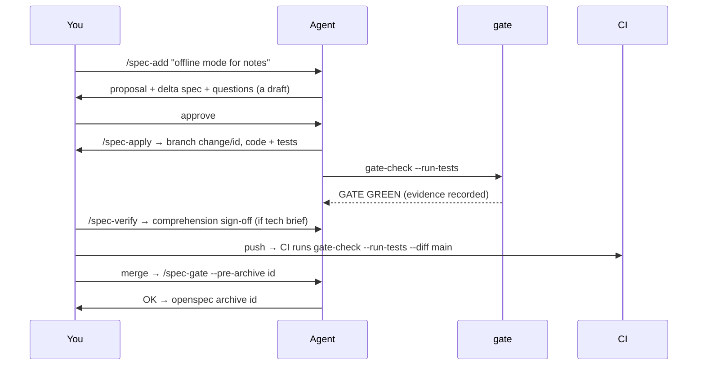
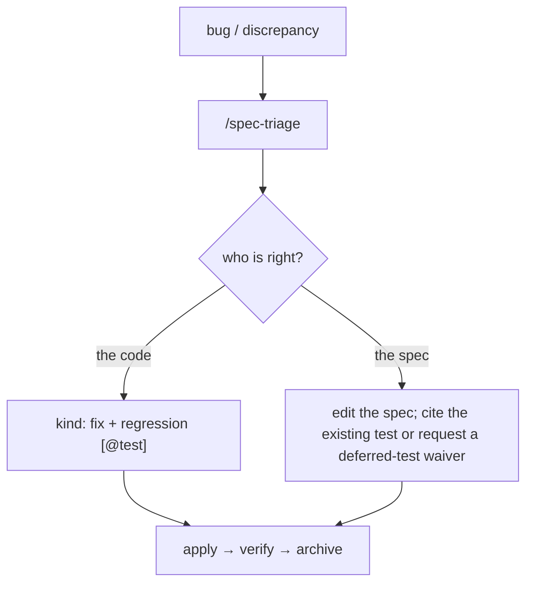

# Workflows

Recipes for the situations that come up most. All of them assume the repository has been bootstrapped (see the [README](../README.md#quickstart)).

## 1. A new feature



1. `/spec-add "<idea>"` — the agent clarifies, proposes alternatives if a technical decision is embedded, and drafts the change.
2. **You approve it** — say so; the agent records `status: accepted` + `accepted_by` / `accepted_at`.
3. `/spec-apply <id>` — implementation on `change/<id>`; tests plus the gate with green evidence; the change reaches `verified` when nothing blocks it.
4. Flagged `tech_brief: true` (persistence/state/network/SDKs/security/new dependency)? The agent writes `walkthrough.md`; run `/spec-verify` to answer the 3 questions — that is where the comprehension sign-off is recorded.
5. Push, review, merge. Update `gitref` (or `merged_as` for squash merges).
6. `--pre-archive <id>` → OK → `openspec archive <id>`.

## 2. A bug (or a discrepancy)



1. `/spec-triage "<symptom>"` — the agent reproduces the behavior, cites the code and the spec, and **asks you which side is right**.
2. Your decision is recorded in `DECISIONS.md`, and a `kind: fix` change is created with a regression test.
3. Apply → verify → archive as usual. If the fix contradicts an older decision, it carries a ⚔ conflict until you approve the reversal.

## 3. A refactor

Same flow as a feature, with `kind: refactor`. The contract does not change, so the green suite is the proof: a regression `[@test]` is mandatory, and `/spec-verify` watches for dead or duplicated behavior.

## 4. A change that touches a protected zone

1. `/spec-add` warns: "🔒 this will require your explicit approval".
2. You review the risk and **explicitly approve** (or not).
3. The agent records `human_approved: true` **and** appends the approval line to `DECISIONS.md`.
4. An unapproved zone touch is an error while the change is `applying` (and stays an error later, until the record exists).

## 5. Requesting a waiver (and granting it)

1. The agent (or you) records the deviation in `.openspec.yaml`:

   ```yaml
   waivers:
     - type: deferred-test
       state: requested
       reason: "integration tests need the staging database"
   ```

2. It appears on the BOARD under ⚠. While `requested`, it **blocks** `verified` and `--pre-archive`.
3. You grant it — the agent records `state: granted` + `owner` + `expires` (a date you give). A valid granted waiver **enables**; its expiry is its closure.
4. Rejecting = removing the entry.

## 6. A conflict with a past decision ⚔

1. When creating or verifying a change, the agent finds that it contradicts an ADR or a living requirement, and records it:

   ```yaml
   conflicts:
     - with: "DECISIONS.md#2026-10-01"
       what: "proposes SQLite against the Postgres decision"
       proposal: "revert the previous decision"
   ```

2. The BOARD shows it under ⏸ as a ⚔ item. Pending = no `verified`, no `--pre-archive`.
3. You approve the reversal explicitly → the agent removes the entry and appends the reversal ADR. Or you reject it, and the change adapts.

## 7. Archiving and compaction

- Before archiving: `--pre-archive <id>` must be **OK** (verified · no blocking waivers · no decisions · no conflicts · tech brief complete + signed off · merge verified against the current target state).
- `openspec archive <id>` moves the folder to `openspec/changes/archive/YYYY-MM-DD-<id>/`.
- Periodically: `node scripts/gates/compact-archive.mjs --days=90` (dry run) → review → `--apply`. Old folders become one line each in `archive/YYYY.md`, and nothing dirty is ever deleted. If the change had a tech brief, the digest keeps its mechanism line; the detailed walkthrough stays in git history.

## 8. Understanding existing behavior (`/spec-explain`)

1. `/spec-explain "how settings are persisted"` — the agent traces the real path in the code (`file:line`), with no assumptions.
2. It delivers a step-by-step mechanism, physical traceability, limits and failure modes, touched APIs, and a Mermaid flow — and (for hard-won knowledge) anchors a note under `docs/mechanisms/`.
3. If the code is opaque, it proposes a `kind: refactor` change; if the behavior is in no spec, it proposes `/spec-add` or `/spec-triage`. It never edits code or specs.
